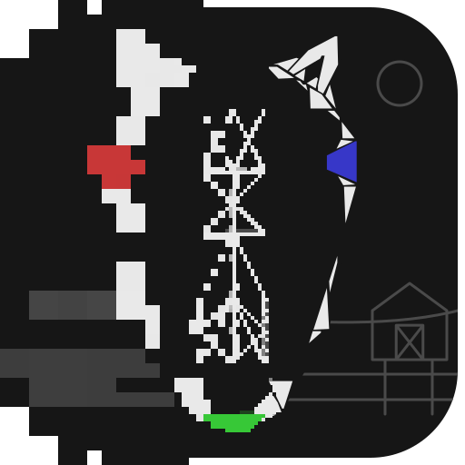

<p align="center">
  
</p>

# Variation CLI Engine (vnce)

[](https://github.com/hanilr/VNCE/actions/workflows/ci.yml)

`vnce` is a Rust library for building graphics, animations and games that run in the
terminal, rendered on the **CPU** or the **GPU**.

It is part of the **Variation** ecosystem.

> **Status:** early development (Phase 18: core types, terminal layer, game loop, pixel
> graphics, terminal graphics protocols, GPU rendering with light and fog, widgets, game
> building blocks, audio, a tutorial, an optimization pass, the showcase games Relay, Isle
> and Glide, and a native window backend). The API is not stable yet.

## Usage

```toml
[dependencies]
vnce = "0.1"
```

```rust,no_run
use vnce::vnce_core::{Color, Style};
use vnce::vnce_term::Terminal;

fn main() -> std::io::Result<()> {
    let mut terminal = Terminal::enter()?;
    terminal.draw(|frame| {
        frame
            .buffer_mut()
            .set_string(0, 0, "Hello!", Style::new().fg(Color::Green).bold());
    })?;
    Ok(())
}
```

For games, implement `vnce_runtime::Game` and call `vnce_runtime::run`: updates run at a fixed
rate, frames at a configurable limit, and `ctx.input()` tells which keys are held down.

For pixel graphics, draw on a `vnce_raster::Canvas` (lines, shapes, triangles, sprites, PNG
images) and convert it into cells with `canvas.render(buffer, area, mode, &options)`. Text
goes into pixels with `canvas.text(Font::builtin(), x, y, "SCORE", color)`.
`PixelMode::detect` picks a mode that works on the current terminal.

For real pixels, call `frame.draw_image(area, &canvas)`: it uses the Kitty, Sixel or iTerm2
graphics protocol when the terminal supports one (detected automatically) and falls back
to cells everywhere else.
Only the parts of an image that changed are sent again, so moving sprites stay cheap. Inside
tmux, Sixel works when tmux draws it (tmux 3.4 or newer built with Sixel), and Kitty
images work with `set -g allow-passthrough on` in the tmux configuration; without it,
starting takes about 300 ms longer while the query waits for the outer terminal.

For GPU rendering, enable the `gpu` feature (`vnce = { version = "0.1",
features = ["gpu"] }`): `vnce_gpu` renders with `wgpu` (Vulkan, DX12, Metal or OpenGL, with a
software fallback) into a `RenderTarget` that is read back into a canvas and shown like any
other image. It comes with a full-screen shader helper (`ShaderQuad`) and a 3D mesh renderer
(`MeshRenderer`, with sun and ambient light and distance fog); your own `wgpu` render passes
work too.

To release a game, enable the `window` feature: `vnce::run` then opens the same game in its
own native window (`winit` and `wgpu`), with cells drawn on the GPU from the bundled
JetBrains Mono font, images in real pixels, GPU pictures shown without a readback, and
F11 / Alt+Enter for fullscreen; `--terminal` keeps the terminal. See
[`docs/SHIPPING-GAMES.md`](docs/SHIPPING-GAMES.md).

For interfaces, `vnce_ui` (feature `ui`, on by default) has a small set of widgets: `Layout`,
`Paragraph` (wrapping, alignment, `…`), `Block` (borders and titles), `Gauge`, `List` (menus),
`FpsOverlay` and `Clear` (popups). They draw into `frame.buffer_mut()` next to pixel
graphics.

For games, `vnce_game` (feature `game`, on by default) has key bindings (`ActionMap`),
collision (`Aabb`, `move_and_collide` through solid tiles, `SpatialGrid`), sprite sheets
and animation, tile maps loaded from text, a following `Camera`, scenes (`SceneStack`:
title, play, pause …), timers, a seeded random generator (`Rng`) and save files
(`SaveFile`) for best scores, settings and key bindings.

For sound, enable the `audio` feature: `vnce_audio` mixes sounds (volume, pan, speed,
looping, fades, music and effects groups), decodes WAV (and OGG Vorbis with the `ogg`
feature), generates retro sound effects and tunes in code (`Synth`, `Preset`, `Melody`)
and plays them on the default device with `cpal`. Without a device, games stay silent
instead of failing. On Linux the `audio` feature needs the ALSA development files
(`libasound2-dev` on Debian / Ubuntu, `alsa-lib-devel` on Fedora).

New to the engine? The [tutorial](docs/tutorial/README.md) builds a game step by step,
from the first window to sprites, tile maps, scenes, saving and sound.

Run the bundled examples (press `q` or `Esc` to quit):

```sh
cargo run --example hello             # styles, colors, Unicode, input events
cargo run --example stars             # a small game: arrows/WASD, +/- to change the FPS
cargo run --example ui                # widgets: menu, gauges, chart, popup, FPS overlay
cargo run --release --example platformer   # a small platformer: arrows/WASD, Space, P
cargo run --release --example platformer --features audio   # … with sound and music
cargo run --release --example sfx --features audio          # sound effect workshop
cargo run --release --example lantern      # a cave game: arrows/WASD, P, settings menu
cargo run --release --example relay --features gpu,audio   # the showcase: every feature in one game
cargo run --release --example isle --features gpu,audio    # the 2.5D showcase: an isometric island
cargo run --release --example glide --features gpu,audio   # the 3D showcase: a flight through rings
cargo run --release --example raster  # pixel graphics; M: pixel mode, D: dithering
cargo run --release --example raster -- image.png   # show a PNG image
cargo run --release --example image   # real pixels (Kitty / Sixel / iTerm2); G: method
cargo run --release --example image -- photo.png
cargo run --release --features gpu --example gpu_shader   # GPU raymarching; G: method
cargo run --release --features gpu --example gpu_cube     # GPU 3D cubes; M: anti-aliasing
cargo run --release --example perf    # timings of the per-frame work (no screen output)
```

Environment overrides:

- `VNCE_COLOR_DEPTH`: `truecolor`, `256`, `16` or `none`.
- `VNCE_PIXEL_MODE`: `halfblock`, `quadrant`, `sextant`, `octant`, `braille` or `ascii`.
- `VNCE_GRAPHICS`: `kitty`, `sixel`, `iterm2`, `cells` or a pixel mode name.
- `VNCE_SIXEL_ASPECT`: `2` sends Sixel images at half height with rows two pixels tall
  (on by default in Windows Terminal, which supports it), `1` turns it off.
- `VNCE_SCALE_QUALITY`: `fast` (default: two passes on several threads, a channel can be
  off by one) or `exact` (the reference result, slower) for scaling images to their area.
- `VNCE_GPU_BACKEND`: `vulkan`, `dx12`, `metal` or `gl` (comma-separated list).
- `VNCE_GPU_POWER`: `high` (fastest GPU, default) or `low` (most power-efficient GPU).
- `VNCE_TERMINAL`: `1` keeps a game built with the `window` feature in the terminal (like
  `--terminal`).
- `VNCE_WINDOW_SCREENSHOT`: a `.png` path; the window saves one frame there (frame 30, or
  the one set with `VNCE_WINDOW_SCREENSHOT_FRAME`).

## Supported platforms

| Platform | Terminals                                                       | GPU backends         | Native window                          |
| -------- | --------------------------------------------------------------- | -------------------- | -------------------------------------- |
| Windows  | Windows Terminal, classic console (conhost)                     | DX12, Vulkan, OpenGL | Yes                                    |
| Linux    | Kitty, WezTerm, foot, Ghostty, Alacritty, GNOME, Konsole, xterm | Vulkan, OpenGL       | X11 and Wayland (needs `libxkbcommon`) |
| macOS    | Terminal.app, iTerm2, Kitty, WezTerm, Ghostty                   | Metal                | Yes                                    |

Every feature falls back gracefully: cells instead of graphics protocols, half blocks or
ASCII instead of finer pixel modes, 256 or 16 colors instead of truecolor, and a software
GPU adapter (or the CPU renderer) without a GPU. The CI workflow
(`.github/workflows/ci.yml`) tests all three platforms.

## Building

Requires Rust 1.87 or newer.

```sh
cargo build
cargo test
cargo clippy --all-targets --all-features
cargo fmt --all --check
```

## Project layout

| Path                      | Contents                                      |
| ------------------------- | --------------------------------------------- |
| `crates/vnce/`            | The main library crate (`vnce`).              |
| `crates/vnce-core/`       | Core types (`vnce_core`).                     |
| `crates/vnce-term/`       | Terminal layer (`vnce_term`).                 |
| `crates/vnce-runtime/`    | Game loop and input state (`vnce_runtime`).   |
| `crates/vnce-raster/`     | Pixel canvas and pixel modes (`vnce_raster`). |
| `crates/vnce-gpu/`        | GPU rendering with `wgpu` (`vnce_gpu`).       |
| `crates/vnce-ui/`         | Widgets (`vnce_ui`).                          |
| `crates/vnce-game/`       | Game building blocks (`vnce_game`).           |
| `crates/vnce-audio/`      | Sound (`vnce_audio`).                         |
| `crates/vnce-window/`     | Native window (`vnce_window`).                |
| `tools/gen-block-tables/` | Generates block-character tables.             |
| `docs/ARCHITECTURE.md`    | High-level design.                            |
| `docs/SHIPPING-GAMES.md`  | Releasing a game in a native window.          |
| `docs/RELEASING.md`       | Releasing the engine's crates.                |
| `docs/tutorial/`          | Step-by-step tutorial (tested as doc-tests).  |
| `docs/plans/`             | Approved implementation plans.                |
| `CHANGELOG.md`            | Release history.                              |

## License and attribution

Copyright 2026 Hakkı Anıl Ragıboğlu (hanilr).

Licensed under the [Apache License, Version 2.0](LICENSE).

If you use, modify or redistribute this project, you must keep the [`NOTICE`](NOTICE) file
and credit the original author, **Hakkı Anıl Ragıboğlu (hanilr)**, as required by the
license.

**Games made with vnce:** if you release a game or another application that uses vnce as
a library, a visible credit such as "Made with VNCE" (in the credits, on the title screen,
on the store page or in the documentation) is enough; you do not have to ship `NOTICE` or
the license text with it. This additional permission is written in [`NOTICE`](NOTICE). It
does not cover redistributing vnce itself, and third-party parts of a game keep their own
licenses (see [`docs/SHIPPING-GAMES.md`](docs/SHIPPING-GAMES.md)).
